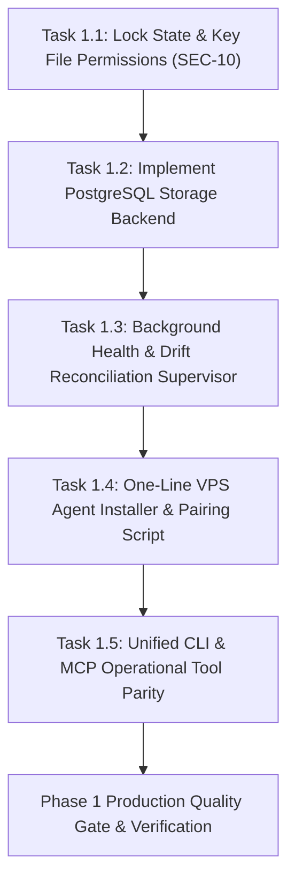

# Smoooth — Phase 0: Technical Audit & Architecture Validation

## 1. Executive Assessment

Smoooth has a substantial, functioning Rust core (v0.1.1) consisting of approximately 18,000 lines of systems code across 15 core modules, backed by 78 passing automated tests. 

The codebase is not a mock or prototype: it contains real container lifecycle management via `bollard`, active PostgreSQL database verification and streaming encrypted backups, domain-separated cryptographic secret storage (`aes-gcm`), Traefik and Caddy reverse proxy bridges, automated zero-Dockerfile Nixpacks builds, and a complete Model Context Protocol (MCP) server supporting 21 tools across the 7-step infrastructure lifecycle.

However, the repository currently reflects an evolutionary transition:
1. **Infrastructure Core is Solid, Backend BaaS Layer is Unbuilt:** The infrastructure engine (Docker, PostgreSQL, Redis, Mongo, Ingress, Backups, Nixpacks) is functional and verified. However, the higher-level backend application services envisioned in the Master PRD (Better Auth user management, file storage buckets, email via Resend, billing via Stripe, and realtime websockets) do not exist yet.
2. **Dual Dashboard Architecture:** The codebase contains two separate frontend representations: an embedded, single-binary HTML/CSS dashboard in `src/dashboard/mod.rs` (120 KB, inspired by the Overseer design system) served directly by the Rust daemon on port 4040, and an external marketing/landing web application in `frontend/` built with Farm.js, React 19, and Tailwind v4.
3. **State Storage is Local-First:** All durable state (resources, plans, operations, agent identities, audit logs) is managed through `LocalStorage` in `src/storage/local.rs` writing to an atomic JSON snapshot file (`smoooth_state.json`). While a full PostgreSQL relational schema exists in `migrations/0001_initial_control_plane.sql`, a PostgreSQL implementation of the `Storage` trait has not yet been wired into the runtime daemon.
4. **Security Boundaries are Active:** The security kernel features Ed25519 proof-of-possession capability verification, strict anti-self-approval enforcement for AI agents, non-root Nixpacks builds without Docker socket mounts, and domain-separated encryption.

---

## 2. Current Architecture

```mermaid
graph TD
    User["Human Operator (Browser / CLI)"] -->|HTTP / REST| API["Smoooth API Gateway (:4040)"]
    Agent["AI Coding Agent (Claude, Gemini, Cursor)"] -->|JSON-RPC 2.0 (stdio / HTTP)| MCP["Model Context Protocol Server"]
    Cloud["Smoooth Cloud (Control Plane)"] -.->|Outbound mTLS / WSS| DaemonClient["DaemonSyncClient (Outbound)"]

    subgraph "Local VPS Boundary (Smoooth Daemon)"
        API --> Orchestrator["Orchestrator Engine"]
        MCP --> Orchestrator
        DaemonClient --> Orchestrator

        Orchestrator --> SecretStore["SecretStore (AES-256-GCM)"]
        Orchestrator --> LocalStorage["Storage Kernel (LocalStorage / JSON)"]

        Orchestrator --> Runtime["RuntimeProvider Trait"]
        Runtime --> DockerAdapter["DockerRuntimeProvider (bollard)"]

        Orchestrator --> PostgresAdapter["PostgresAdapter"]
        PostgresAdapter --> PostgresBackup["PostgresBackupManager (Streaming & AES-GCM)"]

        Orchestrator --> IngressBridge["Ingress Bridge (Traefik / Caddy)"]
        Orchestrator --> BuildEngine["BuildEngine (Nixpacks Isolation)"]
    end

    subgraph "Host OS & Virtualization"
        DockerAdapter --> HostDocker["Host Docker Engine (/var/run/docker.sock)"]
        HostDocker --> Containers["App Containers (no-new-privileges)"]
        HostDocker --> PGContainer["PostgreSQL 16 (Named Volumes)"]
        HostDocker --> RedisContainer["Redis 7 (AOF / Password)"]
        IngressBridge --> HostPorts["Host 80 / 443 (Let's Encrypt TLS)"]
    end
```

### Component Breakdown

1. **API Gateway & HTTP Control Plane (`src/api.rs`):**
   - Built on Axum 0.7 and Tower-HTTP.
   - Listens on `127.0.0.1:4040` by default.
   - Provides REST endpoints for resource status, workload deployment, logs, restarts, secret rotations, pending plan approval queues, Nixpacks builds, and health checks.
   - Serves the zero-dependency embedded Overseer dashboard HTML from root (`GET /`).
   - Serves SSE streaming events (`GET /sse`) and HTTP MCP endpoints (`POST /mcp`).

2. **Model Context Protocol Server (`src/mcp/server.rs`):**
   - Supports both `stdio` transport (for CLI coding agents like Claude Code) and HTTP JSON-RPC 2.0 (for remote agents).
   - Exposes 21 tools covering the 7-step infrastructure lifecycle: Discover, Plan, Govern, Provision, Connect, Verify, Operate.
   - Enforces agent-scope policies (`ReadOnly`, `Plan`, `Deploy`, `Destructive`, `Admin`) and cross-workspace isolation on every tool call.
   - Returns structured machine-actionable diagnostics (`error_code`, `remediation`) upon failure.

3. **Orchestrator Engine (`src/engine/orchestrator.rs`):**
   - Coordinates multi-step transactional infrastructure deployments.
   - Topological dependency resolution (Kahn's algorithm) ensuring prerequisite resources (e.g. databases) become verified and healthy before dependent workloads execute.
   - Monotonic fencing leases (`lease_epoch`) preventing split-brain writes during multi-worker operations.
   - Synthesizes ephemeral Ed25519 execution permits validating monotonic deadlines and target resource URNs.

4. **Runtime Provider Abstraction (`src/runtime/mod.rs`):**
   - Asynchronous `RuntimeProvider` trait decoupling the engine from Docker specifics.
   - `DockerRuntimeProvider` (`src/runtime/docker.rs`) manages containers via `bollard` with transactional renaming and rollback on startup failure.
   - `MockRuntimeProvider` (`src/runtime/mock.rs`) enables deterministic testing without requiring Docker daemons.

5. **Database Adapters & Verifiable Backups (`src/adapters/postgres/`):**
   - Provisions PostgreSQL 16 containers with persistent named volume mounts.
   - `PostgresBackupManager` (`src/adapters/postgres/backup.rs`) creates streaming backups encrypted with AES-256-GCM, manifests SHA-256 digests, and validates integrity via ephemeral sandbox restoration.
   - `SupabaseRoleReconciler` (`src/adapters/postgres/reconcile.rs`) automatically reconciles Supabase auth/data roles (`anon`, `authenticated`, `service_role`).

6. **Ingress & Proxy Coexistence (`src/ingress/`):**
   - Generates dynamic Traefik File Provider configurations and Caddy routing rules.
   - Coexists cleanly with pre-existing Coolify Traefik installations without taking over port 80/443 aggressively.

7. **Cryptographic Secret Store (`src/security/crypto.rs`):**
   - Master key loaded via `SMOOOTH_MASTER_KEY` or `smoooth_master.key`.
   - Domain-separated subkeys derived via HKDF-SHA256 (`"service_binding"`, `"env"`, `"backup"`, `"postgres_backup"`).
   - Zero-credential leakage: sensitive tokens, passwords, and connection strings are masked with `[REDACTED]` in API and MCP outputs unless explicitly requested by an authorized Admin.

8. **Durable State Storage (`src/storage/`):**
   - Thread-safe `LocalStorage` protected by `tokio::sync::RwLock`.
   - Persists atomically via temporary file write and atomic rename to `smoooth_state.json`.

---

## 3. Repository Map

```text
Smoooth/
├── Cargo.toml                    # Rust project manifest (Rust 2021, edition dependencies)
├── Smoooth_PRD_v2.md             # Master PRD (23 sections, long-term vision)
├── migrations/                   # SQL control plane schema
│   └── 0001_initial_control_plane.sql # PostgreSQL DDL for workspaces, plans, operations
├── docs/                         # Architecture, Security, Roadmap & ADRs
│   ├── architecture/             # As-is architecture & ADRs (0001, 0002, 0003)
│   ├── security/                 # STRIDE threat model & security gap analysis
│   └── roadmap/                  # Phased engineering roadmap
├── frontend/                     # Marketing & landing page web app (Farm.js, React 19)
│   ├── package.json
│   └── src/                      # Landing page components & layout
├── src/                          # Core Rust Daemon, CLI, & Engine
│   ├── main.rs                   # CLI entrypoint (clap command hierarchy)
│   ├── lib.rs                    # Library root & module exports
│   ├── api.rs                    # Axum REST gateway, SSE, & approval endpoints
│   ├── dashboard/                # Embedded Overseer control dashboard (single-binary HTML)
│   ├── engine/                   # State machine orchestrator & dependency DAG
│   ├── runtime/                  # RuntimeProvider async trait & Docker/Mock backends
│   ├── adapters/                 # Infrastructure adapters (Docker, Postgres, Redis, Mongo)
│   │   ├── docker/               # Bollard container, network, volume managers
│   │   └── postgres/             # Database provisioning, reconciliation & backup
│   ├── mcp/                      # Model Context Protocol server (stdio & HTTP)
│   ├── models/                   # Strongly typed specifications (WorkloadSpec, Tenancy, URN)
│   ├── security/                 # AES-256-GCM crypto, Ed25519 PoP, backup archives
│   ├── storage/                  # Storage trait & LocalStorage implementation
│   ├── ingress/                  # Traefik & Caddy dynamic reverse proxy bridge
│   ├── build/                    # Nixpacks automated image generation
│   ├── doctor/                   # VPS preflight diagnostics
│   ├── migration/                # Foreign manifest importer (Coolify, Compose, Render, Fly)
│   └── cloud/                    # Outbound hybrid cloud daemon protocol & RBAC
└── tests/                        # Automated integration & verification test suite
    ├── adversarial_security_test.rs     # Security boundary, scope & isolation tests (10 tests)
    ├── agent_operational_workflow_test.rs # Approval queue & MCP alias tests (2 tests)
    └── runtime_provider_test.rs         # Container lifecycle & spec validation tests (2 tests)
```

---

## 4. Feature Inventory

| Capability | Status | Evidence in Code / Tests |
| :--- | :--- | :--- |
| **Local VPS Diagnostic Preflight** | Implemented & Verified | `smoooth doctor`, `src/doctor/mod.rs`, checks Docker, ports, architecture |
| **Typed Container Lifecycle** | Implemented & Verified | `WorkloadSpec` in `src/models/workload.rs`, `RuntimeProvider` in `src/runtime/mod.rs` |
| **Docker Engine Decoupling** | Implemented & Verified | `RuntimeProvider` async trait, `MockRuntimeProvider` passing in `tests/runtime_provider_test.rs` |
| **PostgreSQL Provisioning** | Implemented & Verified | `src/adapters/postgres/mod.rs`, persistent volume protection, active connection verification |
| **Encrypted Database Backups** | Implemented & Verified | `PostgresBackupManager` in `src/adapters/postgres/backup.rs`, AES-256-GCM, sandbox restore |
| **Supabase Role Reconciliation** | Implemented & Verified | `src/adapters/postgres/reconcile.rs`, sets up `anon`, `authenticated`, `service_role` |
| **Redis & Mongo Adapters** | Implemented & Verified | `src/adapters/redis/mod.rs`, `src/adapters/mongo/mod.rs`, AOF persistence, auth credentials |
| **Agent Scopes & Token Auth** | Implemented & Verified | `smoooth_ag_...` tokens, SHA-256 hashing, revoked tokens reject 401 in `tests/adversarial_security_test.rs` |
| **Anti-Self-Approval Enforcement** | Implemented & Verified | MCP & REST reject agent self-approval; returns 202 on production deploy in `tests/adversarial_security_test.rs` |
| **Cryptographic Execution Permits** | Implemented & Verified | Ed25519 PoP permits wired into `authorized_provision` / `authorized_destroy` in `src/engine/orchestrator.rs` |
| **Human Approval Queue** | Implemented & Verified | `GET /api/plans/pending`, `POST /api/plans/:id/reject` in `src/api.rs`, verified in `tests/agent_operational_workflow_test.rs` |
| **MCP stdio & HTTP Protocol** | Implemented & Verified | `src/mcp/server.rs`, 21 tools, JSON-RPC 2.0, structured diagnostic error payloads |
| **Nixpacks Automated Builds** | Implemented & Verified | `src/build/mod.rs`, unprivileged generator, no Docker socket mount, image tag validation |
| **Foreign Stack Migration** | Implemented & Verified | `src/migration/mod.rs`, parses Compose, Coolify, Render, Fly, Dokku manifests |
| **Ingress & Domain Routing** | Implemented & Verified | `src/ingress/bridge.rs`, Traefik File Provider & Caddy dynamic configuration |
| **Embedded Operator Dashboard** | Implemented & Verified | `src/dashboard/mod.rs`, single-binary HTML/CSS UI matching Overseer design |
| **Outbound Daemon Sync Protocol**| Implemented & Verified | `DaemonSyncClient` in `src/cloud/mod.rs`, heartbeats, local authority (ADR 0003) |
| **Team RBAC & Entitlements** | Implemented & Verified | `src/cloud/rbac.rs` & `src/cloud/entitlement.rs`, Community through Business tiers |
| **PostgreSQL State Storage** | Partially Implemented | SQL DDL ready in `migrations/0001_initial_control_plane.sql`; `PostgresStorage` not wired |
| **Remote SSH VPS Provisioning** | Planned but Not Implemented| Remote server registration is currently daemon-first (local install); automated SSH bootstrapping is unbuilt |
| **Better Auth Integration** | Planned but Not Implemented| Described in Master PRD Section 8; no Better Auth schema, endpoints, or plugins in repo |
| **Object / S3 File Storage** | Planned but Not Implemented| Described in Master PRD Section 8; MinIO / S3 adapter unbuilt |
| **Realtime WebSockets & Queues** | Planned but Not Implemented| Described in Master PRD Section 8; background job workers unbuilt |
| **Stripe Billing Integration** | Planned but Not Implemented| Described in Master PRD Section 8; entitlement engine exists in memory, payment webhooks unbuilt |

---

## 5. Security Assessment (14 Dimensions)

### Findings by Severity

| Category | Finding ID | Severity | Status | Description |
| :--- | :--- | :--- | :--- | :--- |
| **Docker Socket Access** | SEC-01 | **CRITICAL** | **RESOLVED** | Nixpacks build previously mounted `/var/run/docker.sock`. Removed; isolated unprivileged generator now used with `--security-opt no-new-privileges:true`. |
| **Agent Permissions** | SEC-02 | **HIGH** | **RESOLVED** | Agents could previously self-approve plans. Now blocked in MCP and REST; production deployments return 202 Accepted awaiting human approval. |
| **Container Isolation** | SEC-03 | **HIGH** | **RESOLVED** | Raw JSON allowed arbitrary host path volume bind mounts. Replaced with typed `WorkloadSpec` rejecting host paths, `/proc`, `/sys`, and `/var/run/docker.sock`. |
| **Input Validation** | SEC-04 | **HIGH** | **RESOLVED** | Image tags and git clone arguments previously vulnerable to option injection. Added `validate_image_tag` and `--` delimiter. |
| **Destructive Operations**| SEC-05 | **HIGH** | **RESOLVED** | Destructive plan execution and workload deletion now strictly require `AgentScope::Destructive` and human operator approval. |
| **Secret Handling** | SEC-06 | **MEDIUM** | **RESOLVED** | Environment secrets previously revealed in plaintext. Masked with `[REDACTED]` by default; plaintext reveal restricted to Admin/Operator. |
| **Authentication** | SEC-07 | **MEDIUM** | **RESOLVED** | Token revocation previously existed only in storage; now enforced at Axum middleware and MCP dispatch layers with SHA-256 hash lookup. |
| **Audit Logging** | SEC-08 | **LOW** | **RESOLVED** | Audit events sanitized to ensure raw bearer tokens and token hashes are never recorded in audit payloads. |
| **Remote Command Exec**| SEC-09 | **LOW** | **RESOLVED** | Direct shell `Command::new("docker")` in API handlers replaced with typed `RuntimeProvider` methods. |
| **State File Permissions**| SEC-10 | **LOW** | **OPEN** | `smoooth_state.json` and `smoooth_master.key` written with default OS file masks. On multi-user Linux hosts, permissions should be locked to `0600`. |

---

## 6. Architecture Gap Analysis (Actual Code vs. Master PRD)

| PRD Section & Requirement | Current Repo Implementation | Gap / Action Required |
| :--- | :--- | :--- |
| **Sec 5.1: Infrastructure Foundation** | Docker, Postgres, Redis, Mongo, Ingress, Backups, Nixpacks functional | Add rootless Podman backend; add automated SSH VPS connection script |
| **Sec 5.2: Backend Engine** | Zero application-level backend services in repo | Implement Better Auth integration, MinIO/S3 file storage, and database migrations engine |
| **Sec 5.3: Integration Ecosystem** | No third-party provider integrations | Implement Resend (email), Stripe (billing), and webhook dispatchers |
| **Sec 5.4: Agent Operating Layer** | 21 MCP tools, scopes, anti-self-approval, approval queue | Add automated health drift reconciliation loop and fine-grained capability delegation UI |
| **Sec 6: Hybrid Deployment Model** | Outbound `DaemonSyncClient` protocol per ADR 0003 implemented | Implement managed cloud control plane WebSocket listener to accept customer daemons |
| **Sec 7: Database & Data** | PostgreSQL, Redis, Mongo adapters, streaming backup | Implement PostgreSQL storage backend for control plane state (`PostgresStorage`) |
| **Sec 14: Developer Dashboard** | Single-binary embedded HTML/CSS Overseer dashboard in binary | Reconcile embedded dashboard with external Next.js/React `frontend/` codebase |
| **Sec 15: Commercial Entitlements**| In-memory `EntitlementEngine` & `TeamRole` implemented | Persist license keys and wire entitlement checks into workspace creation routes |

---

## 7. Recommended Phase 1 Architecture

To establish a dependable, production-grade **Infrastructure Foundation** before building higher-level backend services (Better Auth, payments, emails), Phase 1 must focus exclusively on hardening the core infrastructure workflow:

1. **One-Line VPS Agent Bootstrapping:** A curl-to-bash script (`curl -fsSL https://smoooth.dev/install.sh | sh`) that installs the single-binary Smoooth daemon, generates an Ed25519 host identity, verifies Docker/preflight via `Doctor`, and registers with the local or cloud control plane.
2. **PostgreSQL Control Plane Storage Engine:** Implement `PostgresStorage` for the `Storage` trait, enabling Smoooth to run against either an embedded file (`LocalStorage`) or a dedicated PostgreSQL database with connection pooling (`deadpool-postgres`).
3. **Automated Health & Drift Detection Daemon:** A lightweight background supervisor task running in the orchestrator that inspects live container health, checks Traefik/Caddy routes, and alerts on unmanaged configuration drift.
4. **Unified Operational CLI & MCP Tool Parity:** Complete symmetry between CLI commands and MCP tools so human developers and AI coding agents execute identical operations through identical security gates.

---

## 8. Ordered Implementation Roadmap for Phase 1



### Rationale for Ordering
- **Task 1.1 comes first:** Trivial fix closing the last open security finding (file permissions on Linux).
- **Task 1.2 comes second:** Decouples the daemon from single-file JSON persistence, allowing concurrent operations and multi-server scalability.
- **Task 1.3 comes third:** Proactive drift detection ensures resources provisioned by agents remain healthy over time.
- **Task 1.4 comes fourth:** Customer VPS connection requires a reliable, secure agent install flow.
- **Task 1.5 comes fifth:** Finalizes developer and agent ergonomics across terminal and IDE.

---

## 9. First Implementation Task Specification

### Task 1.1: State File Permissions & Key Protection (SEC-10)
- **Objective:** Restrict permissions on `smoooth_master.key` and `smoooth_state.json` to owner-only read/write (`0600` on Unix) to prevent local privilege escalation on shared Linux VPS hosts.
- **Components Involved:** `src/security/crypto.rs`, `src/storage/local.rs`.
- **Required Changes:** Use `std::os::unix::fs::PermissionsExt` (under `#[cfg(unix)]`) when creating or persisting key files and state snapshots.
- **Acceptance Criteria:**
  1. Key file created with mode `0600` on Unix platforms.
  2. State snapshot written with mode `0600`.
  3. Non-destructive on Windows (no compilation breakage).
  4. Unit test verifying file permissions on Unix.
